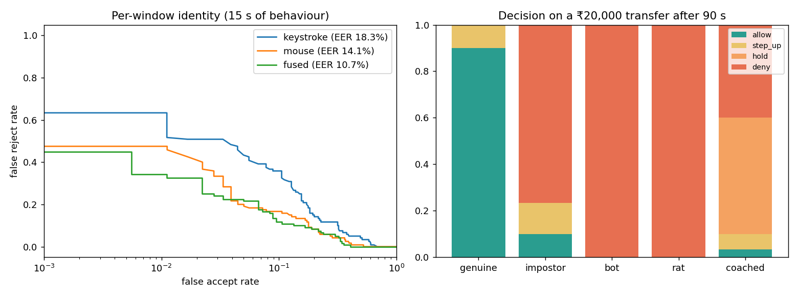

# Behaviour Guard

Continuous authentication for online banking, based on *how* someone types and moves the pointer, not on *what* they type. It runs silently after login and answers three questions:

1. **Is this still the account owner?** Each user has a personal behavioural profile, checked every 15 seconds.
2. **Is a machine or a remote operator driving the session?** Bots and remote-access tools such as AnyDesk are caught from the very first session, with no profile needed.
3. **Is the real customer being coached by a scammer on the phone?** Long silences before typing each field, and payee details pasted rather than typed.

Passwords and OTPs stop none of these. A stolen password passes the login screen. Screen-sharing fraud happens *inside* a genuine session. A coached victim passes every check, because it really is them.

## What it measures

The browser capture script records **timing and movement only**. For keys it stores the *class* (letter, digit, space, backspace, shift), never the character, so no password, account number or message text is collected.

| Keystroke features | Pointer features |
|---|---|
| hold (dwell) time mean/std/median, key-to-key flight, down-to-down latency within a field, typing rate, backspace rate, pause rate, shift hold | speed mean/std/p90, acceleration, curvature, stroke straightness, pauses, click duration, approach-to-click time, sampling interval and jitter, cursor jumps, direction entropy |

**Identity model.** A per-user scaled-Manhattan distance, one per modality: robust centre and spread per feature. This detector scored best in Killourhy & Maxion's keystroke benchmark and needs no impostor data. Each user's own enrollment windows set their personal threshold by leave-one-out. Keystroke and mouse matches are fused, and session trust is updated as a running blend, so a single odd window doesn't lock anyone out.

**Profile-free threat rules:**

| Threat | Tell-tale |
|---|---|
| Bot / scripted input | key hold times varying by < 3 ms, perfectly regular rhythm, perfectly straight mouse paths, machine-exact timing, 3 ms clicks |
| Remote-access tool | pointer updates arriving in video-frame bursts (~30–60 ms), cursor teleports, near-zero key hold times from injected input |
| Coached victim | beneficiary details pasted, repeated 4 s+ silences between opening a field and typing in it |

**Decisions.** For a sensitive action (transfer, add payee, change phone) the session returns allow / step-up (biometric or OTP) / hold / deny, each with a plain-language reason. A coached victim gets a hold with a direct question: *"Are you on a call with someone telling you what to type?"*

## Results

`python -m behavauth evaluate`: 30 simulated users, each with their own typing and mouse habits. Profiles come from three 1-minute sessions.



| | |
|---|---|
| Identity from **15 s** of behaviour (EER) | keystroke 18.3% · mouse 14.1% · **fused 10.7%** |
| Genuine users, ₹20,000 transfer after 90 s | 90% allowed, 10% asked to step up, **0% denied** |
| Impostor with the right password | **77% denied**, 13% step-up, 10% allowed; median **15 s** to first flag |
| Bot sessions | **100% denied** |
| Remote-access takeover | **100% denied** |
| Coached victim | **97% stopped** (50% hold with a scam warning, 40% denied, 7% step-up) |

One 15-second window is weak evidence, which is why EER per window is around 11%. Trust accumulates across windows, and that is how the session-level numbers get much higher. The simulator models real effects (minimum-jerk pointer motion, device sampling rates, remote-desktop frame pacing), but real users are messier. Calibrate on your own traffic, then tune `STEP_UP_BELOW` / `END_BELOW` in `engine.py` and the per-user threshold percentile in `profile.py`.

## Run it

```bash
pip install -r requirements.txt
python -m pytest -q                  # 8 tests
python -m behavauth evaluate         # benchmark -> results/
python -m behavauth seed             # fill the analyst view with example sessions
python -m behavauth serve            # http://127.0.0.1:8007
```

- **http://127.0.0.1:8007**: a demo bank.
  1. Choose a username and run **Teach it my behaviour** for about 2 minutes: retype sentences and click a moving dot.
  2. Sign in and fill the transfer form. The side panel shows trust, per-modality match and any flags live.
  3. Ask someone else to use your username and watch trust fall.
- **http://127.0.0.1:8007/analyst**: every session with its trust timeline and reasons.

## Integrating

1. Add `web/capture.js` to your pages. Every 10–15 s, post `Behaviour.take()` to `/api/session/{id}/events`.
2. Before a sensitive action, call `/api/session/{id}/action` with `{"kind": "transfer", "amount": ...}`.
3. Enroll users passively from their first few genuine sessions (`/api/enroll`), or with a short guided exercise like the demo's.

| Endpoint | Purpose |
|---|---|
| `POST /api/enroll` | `{user, events}`: add one window to the user's profile |
| `GET /api/users/{user}` | enrollment progress |
| `POST /api/session` | `{user}`: start monitoring |
| `POST /api/session/{id}/events` | `{events}`: returns trust, match, action, flags, reasons |
| `POST /api/session/{id}/action` | `{kind, amount}`: allow / step_up / hold / deny with reason |
| `GET /api/sessions` | analyst feed |

Profiles and session logs are stored in SQLite (`BEHAVAUTH_DB`, default `data/behavauth.db`).

| Setting | Purpose |
|---|---|
| `BEHAVAUTH_API_KEY` | require this value in an `X-API-Key` header on every `/api` call (set it when your backend relays browser events) |
| `BEHAVAUTH_SESSION_IDLE_S` | drop monitoring sessions idle for longer than this (default 7200 s) |

## Layout

```
behavauth/
  features.py   keystroke + pointer features from raw events
  profile.py    per-user scaled-Manhattan model with personal thresholds
  threats.py    bot, remote-access and coaching rules
  engine.py     session trust and action gating
  simulate.py   synthetic people, impostors, bots, remote takeovers, coached victims
  evaluate.py   EER curves and session decisions
  store.py      SQLite persistence
  api.py        FastAPI service
web/            capture.js, demo bank, analyst view
```

## Privacy

Behavioural data is biometric data in many jurisdictions; India's DPDP Act treats it as personal data. Tell users about it, keep only feature vectors (this service never stores raw event streams), set a retention period, and let users reset their profile.
